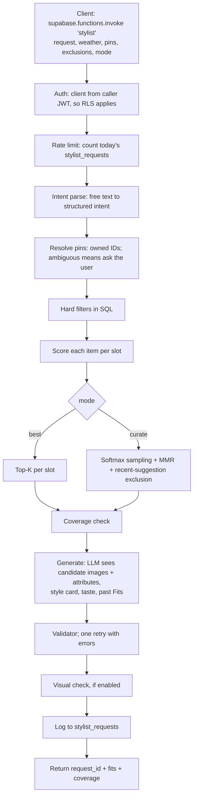
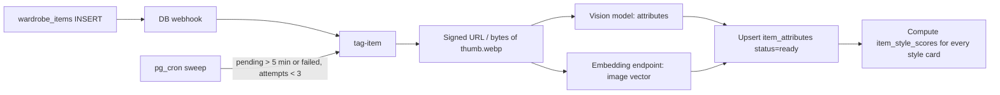

# Pipeline

The request path and the background path. Each step lists which milestone introduces it (`milestones.md`).

## Request path: Edge Function `stylist`



| Step | Behavior | From |
|---|---|---|
| Auth | Supabase client created from the caller's JWT. Every read goes through RLS. Service role only for inserting `stylist_requests`. | v0 |
| Rate limit | Count the caller's `stylist_requests` with `created_at` today; over the cap returns `{status: "over_limit"}`. | v0 |
| Intent parse | Small, fast model call → `{mode, occasion, formality:[min,max], warmth_min, pins_text[], avoid[], vibe_text, style_ids[], slot_ideals{slot: text}}`. `slot_ideals` are short per-slot descriptions of what suits the request ("tops: band tee, worn-in plain tee, thermal"), embedded as text for `style_match`. Chips map directly, without a model call. | v1 (v0 passes the raw text to the generator) |
| Resolve pins | Tapped pins are IDs. Text pins are matched by tags plus embedding similarity; ambiguity returns `{status: "pin_ambiguous", options}`. Ownership is checked for every pin. | v0 (IDs) / v1 (text) |
| Hard filters | Not deleted; attributes `ready`; season/warmth matches the weather; formality in range; `avoid` and never-rules excluded. Pins bypass the filters. | v1 |
| Scoring | `score = w_style·style_match + w_taste·taste_match + w_attr·attribute_fit + w_fresh·freshness − penalties`. Starting weights 0.40 / 0.30 / 0.15 / 0.15, tuned by eval. Penalties: suggested in the last N requests, or part of a dismissed Fit. `taste_match` weight is 0 when there's no taste vector. `style_match` compares an item with the ideal pieces for its slot (`slot_ideals` from the intent, or the style card's from v3), not with the style as a whole. `versatility` comes from attributes: neutral color, solid pattern, wear count. | v1 (style, attr, fresh) / v2 (taste) / v3 (style library) |
| Best mode | Top ~15 per open slot (tuned by eval). 2 of those spots are reserved for the most versatile items in the slot, whatever their style score. | v1 |
| Curate mode | Sample ~15 per slot from `softmax(score / T)` with a fresh seed, keeping the same 2 versatility spots; MMR diversity across the 3 Fits; exclude items shown in the user's last 3 responses. Shuffle = a new seed. | v1 |
| Coverage | For each open slot, count candidates above the style threshold. Thin → `coverage: "partial"` built around the strongest on-style item; none → `coverage: "none"` plus the closest take, labeled as such. | v3 (style) / v1 (slots) |
| Generate | Images before text, each labeled `Item <short-id>:`. Order shuffled. Structured output (see below). | v0 |
| Validator | IDs ⊂ candidates ∪ pins; ownership; every pin present; required slots covered (see slot rules); no duplicate item within a Fit; no item in two Fits unless pinned. One retry with the error list; then return what is valid, with `status: "partial"`. | v0 |
| Visual check | One vision call over each Fit's item images: harmony, clash, proportion. Verdict per Fit: keep, swap slot X, or drop. Swaps take the next best candidate. | v4 (eval-gated) |
| Log | Insert into `stylist_requests`: input, candidate IDs, output, model IDs, tokens, cost, latency, status. | v0 |

## Generation output schema

Reasoning fields come before the picks, so the model reasons first and then chooses.

```json
{
  "fits": [{
    "concept": "string",
    "anchor": { "id": "string", "why": "string" },
    "pieces": [{ "id": "string", "slot": "top|bottom|one_piece|shoes|outerwear|accessory", "role": "string", "why": "string" }],
    "checks": { "palette": "string", "silhouette": "string", "formality": "string", "style_rules": "string" },
    "reason": "string"
  }]
}
```

## Slot rules

- Required: top + bottom, or one_piece; plus shoes.
- `top`: 1, or 2 when one is worn as an open layer over the other (role `layer`, e.g. a flannel over a tee).
- `one_piece`: an item tagged `one_piece` (dress, jumpsuit, overalls). It covers top and bottom; a layer top over it is allowed.
- `outerwear`: optional; required when the forecast is below the cold threshold (set with the warmth mapping).
- `accessory`: 0–3.

## Generation prompt contents (in order)

Ordered from most to least stable so the prefix can be cached: one cache breakpoint after item 2 (the same for every user) and one after item 4 (stable per user for a day).

1. The stylist process: concept → anchor (a pin if present, otherwise the strongest on-request item) → build outward on color, silhouette, formality, texture and context → self-check.
2. 3–5 fixed worked examples of good outfits with their reasoning.
3. Taste summary (v2).
4. v0 only: the full closet in a stable order (a shuffled order is the ablation).
5. The style card(s), including rules and anti-vibe (v3).
6. 3–5 most similar past Fits (v2).
7. Request intent, weather, pins (marked "must appear in every outfit"), exclusions.
8. From v1: candidates with labels and one-line attributes, plus images if the v0 ablation shows they help.

## Fast path: quick shuffle (no LLM)

A quick shuffle with no prompt skips intent parse and generation: hard filters → scoring (taste, freshness, weather) → weighted slot filling with compatibility rules (formality within 1, warmth matches the weather, at most one patterned piece, palette rules on tagged colors) → validator. It returns no reason, or a templated one. Target p95 < 1 s. From v0. The eval compares it with LLM curate mode on outfit score; if the gap is large, pre-generate a daily batch with the LLM instead.

## Background path: Edge Function `tag-item`



- Attributes: subcategory, colors with undertone, pattern, fabric, weight, texture, fit/silhouette, formality 1–5, warmth 1–5, seasons, vibe tags.
- Attributes ship in v0 (vision call only); the embedding is added in v1 and style scores in v3.
- User corrections live in `item_attribute_overrides` and win over `attrs` wherever attributes are read; re-tagging never touches them.
- Backfill: a one-off run over existing items, using the same function.
- Item delete (soft): attributes stay but are filtered out by `deleted_at`.

## Image transport

- Thumbs are 400 px WebP, at most ~225 vision tokens each. With ~15 candidates per slot, images add roughly 15–20k input tokens per request, so the v0 ablation decides whether candidates go as images, as text, or as images only for the top few per slot.
- Signed URLs (short expiry) as `url` image sources, or base64 when URL fetching is unreliable. v0 decides which, based on measured reliability.
- If transparency degrades results, flatten onto a neutral background (`#F2F0EC`-class off-white) before sending.
